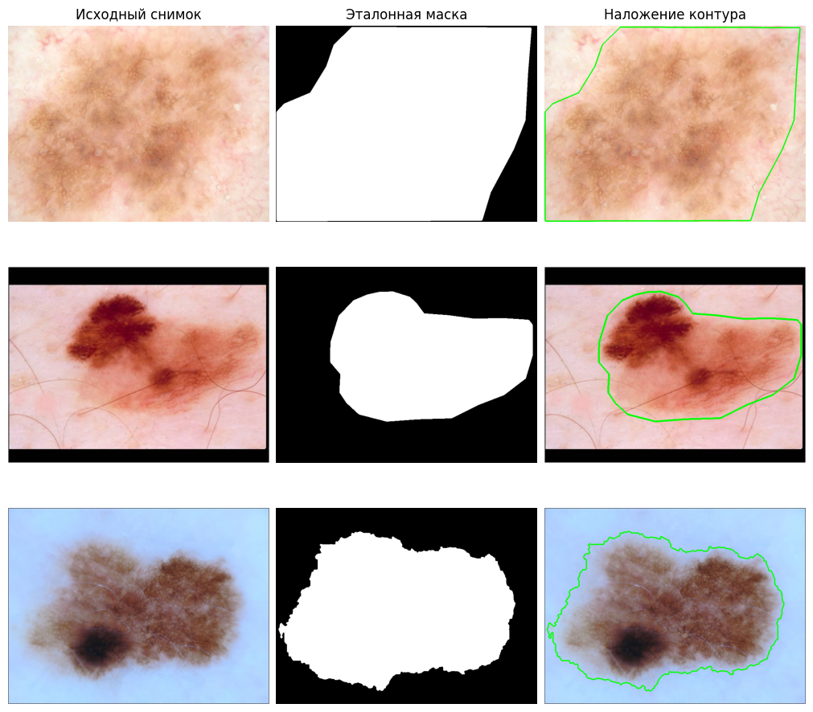
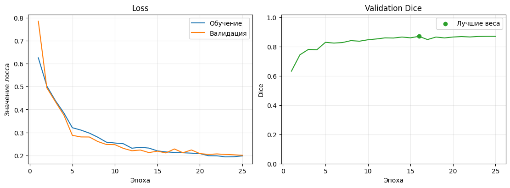
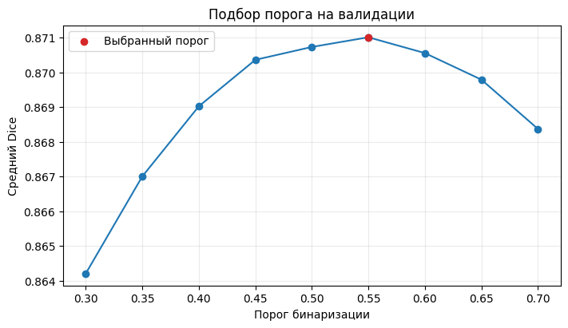
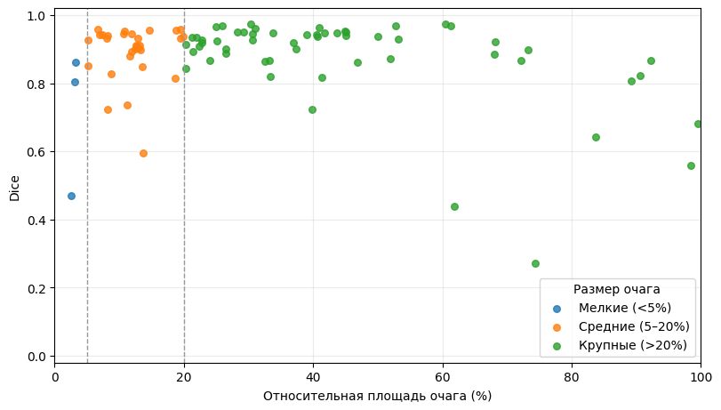
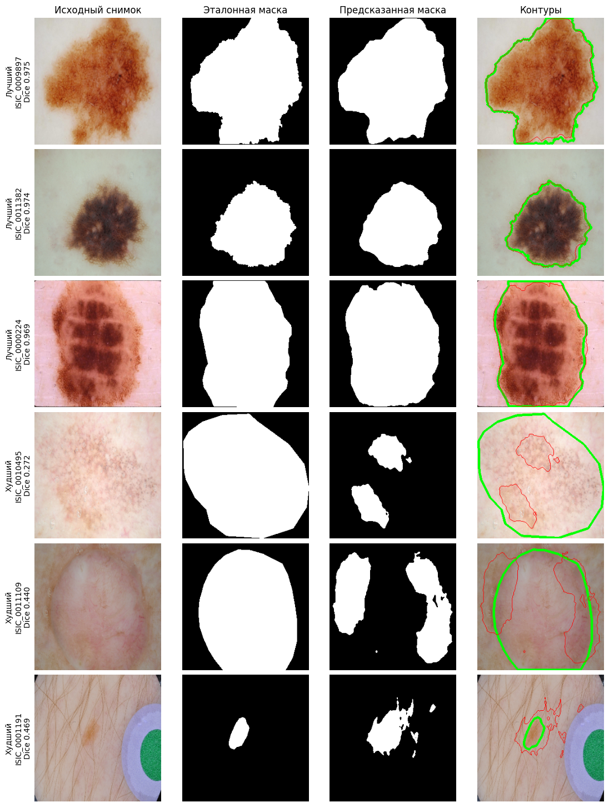

# 1. Название проекта

**Сегментация кожных очагов на дерматоскопических снимках с помощью U-Net**

# 2. Цель проекта

Обучить U-Net выделять кожный очаг на дерматоскопическом снимке и измерить качество бинарной сегментации на отложенной выборке.

# 3. Задачи проекта

- Загрузить снимки и эталонные маски ISIC 2016 Task 1.
- Удалить точные и близкие дубликаты до разбиения на train, val и test.
- Обучить U-Net с комбинированной функцией потерь Dice + Focal Loss.
- Выбрать лучшие веса и порог бинаризации на валидации, затем оценить модель на тесте.
- Сравнить метрики по размеру очага и разобрать предсказания с самым низким Dice.

# 4. Методология и инструменты

Зафиксировалт `seed = 42` для Python, NumPy, PyTorch и CUDA. Точные копии нашли по SHA-256 декодированных RGB-пикселей, близкие — по pHash с расстоянием Хэмминга до 4 включительно. После очистки разбили данные в пропорции 80/10/10.

Привели изображения и маски к размеру 256 × 256. Для масок использовали интерполяцию по ближайшему соседу. Геометрические и цветовые аугментации Albumentations применили только при обучении. Собрали U-Net с четырьмя уровнями энкодера на 32, 64, 128 и 256 каналов, промежуточным блоком на 512 каналов, skip-связями и выходной свёрткой 1 × 1.

Обучили модель в PyTorch за 25 эпох со смешанной точностью CUDA. Использовали AdamW с начальным шагом `1e-3` и `weight_decay = 1e-4`, планировщик CosineAnnealingLR и функцию потерь `L = 1 − Dice + λ × Focal Loss` при `λ = 1`. Для подготовки и анализа данных использовали также OpenCV, Pillow, NumPy, ImageHash и Matplotlib.

Выбрали веса по максимальному среднему Val Dice при пороге 0,50. С этими весами сравнили пороги от 0,30 до 0,70 с шагом 0,05 на валидационной выборке. На отложенном тесте усреднили Dice, IoU (Jaccard) и Boundary IoU по снимкам. Для Boundary IoU сравнили внутренние полосы масок шириной 3 пикселя. Ошибку границы рассчитали как `1 − Boundary IoU`. Размер очага определили по доле эталонной маски до ресайза.

# 5. Источники данных

Скачали напрямую из архива ISIC обучающие архивы ISIC 2016 Task 1 по лицензии CC0. Они содержали 900 дерматоскопических снимков и 900 соответствующих бинарных масок. Тестовую выборку эксперимента выделили из этих пар после очистки. [Описание ISIC 2016 Task 1](https://challenge.isic-archive.com/landing/2016/37/) · [Архивы и лицензии ISIC](https://challenge.isic-archive.com/data/#2016)

# 6. Результаты и выводы

Удалили одну точную и восемь близких копий. Из 891 оставшейся пары 713 вошли в train (80,0%), 89 в val (10,0%) и 89 в test (10,0%). На исходных 900 масках средняя доля очага составила 27,09%, медианная — 21,35%, диапазон — от 1,16% до 99,54%. Средняя доля фона составила 72,91%.

Лучшие веса получили на **16-й эпохе** с **Val Dice 0,8707** при пороге 0,50. После подбора порога **0,55** на тех же весах Val Dice составил **0,8710**.

| Размер очага | Снимков | Dice | IoU | Boundary IoU | Ошибка границы |
| --- | ---: | ---: | ---: | ---: | ---: |
| Весь тест | 89 | **0,8758** | **0,7957** | **0,1407** | **0,8593** |
| Мелкие (<5%) | 3 | 0,7119 | 0,5790 | 0,1663 | 0,8337 |
| Средние (5–20%) | 30 | 0,8920 | 0,8136 | 0,1812 | 0,8188 |
| Крупные (>20%) | 56 | 0,8759 | 0,7977 | 0,1176 | 0,8824 |

Самый низкий средний Dice получили на мелких очагах, а самую высокую среднюю ошибку границы — на крупных. В двух худших случаях по Dice модель пропустила 84,3% очага на `ISIC_0010495` (Dice 0,272) и 67,1% на `ISIC_0011109` (Dice 0,440). На части пропущенных границ измерили низкий контраст. На `ISIC_0001191` (Dice 0,469) модель выделила весь мелкий очаг и добавила в маску 6,0% фоновых пикселей.

Модель выделяет область интереса для специалиста, но маска сама по себе не является диагнозом.

# 7. Визуализация данных и результатов

На трёх примерах исходных данных показали снимок, эталонную маску и её контур.

По 25 эпохам построили кривые лосса и валидационного Dice. На отдельном графике сравнили пороги бинаризации на валидации.

Для каждого тестового снимка сопоставили Dice с долей кадра, занятой эталонным очагом.

Показали три лучших и три худших предсказания по Dice. Зелёным отметили эталонный контур, красным — предсказанный.

# 8. Применение результатов

На тестовых примерах показали, как наложить предсказанный контур на снимок, чтобы специалист мог проверить выделенную область. Модель выделяет область интереса для специалиста, но маска сама по себе не является диагнозом.

# 9. Ограничения и сложности

В тестовой группе мелких очагов было всего три снимка, поэтому её средний Dice чувствителен к каждому случаю. Оценку провели на одном разбиении архива ISIC 2016 Task 1. Совпадения пациентов между выборками и переносимость на снимки из других источников не проверяли.

При ресайзе до 256 × 256 часть мелких деталей границы могла теряться. При разборе ошибок отметили слабый контраст на пропущенных участках границы и тёмные детали в зоне лишнего выделения. Вклад Focal Loss отдельно не измеряли.
